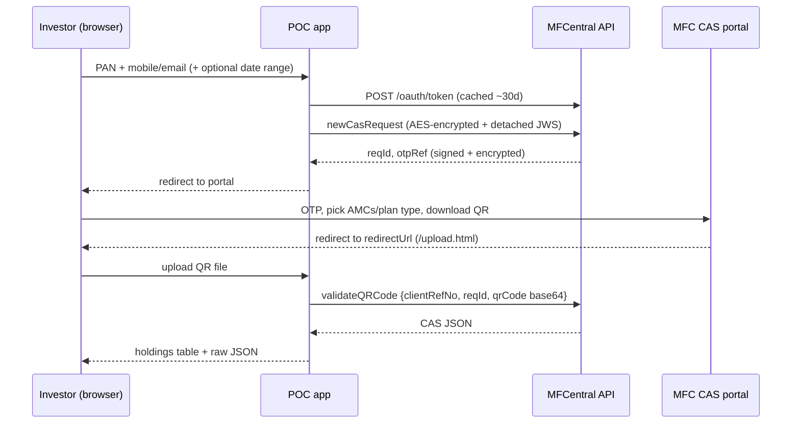

# MFCentral CAS POC

A throwaway spike. It fetches one investor's Consolidated Account Statement through MFCentral's QR-based
CAS flow ("CAS Flow: Modified" doc). It is not production code: state is in memory, there's no auth on the
UI, and it's meant for one user on localhost.

## Flow



Only `newCasRequest` and `validateQRCode` are called from here. `investorconsent` and `generateQRCode` run
inside MFC's hosted portal in this flow.

## Setup

Credentials stay outside the project, and you don't share them anywhere, including AI chat sessions.

```bash
mkdir -p ~/.mfcentral && chmod 700 ~/.mfcentral
cp config/mfcentral-secrets.example.properties ~/.mfcentral/secrets.properties
chmod 600 ~/.mfcentral/secrets.properties
# fill in values; put your private key JWKS and MFC's public key JWKS at the paths it names
```

DECISION: the POC runs on FundsIndia's shared PROD MFCentral client at the owner's explicit request. The risk is
that the live app's token gets rotated, or the calls get rejected by MFC's IP whitelist.

Set `MFC_SECRETS_FILE` to use a different path. If any value is missing, startup fails with the property's name.

## Run

```bash
mvn spring-boot:run          # http://localhost:8080
mvn test                     # runs the flow against a fake MFC that really encrypts and signs
```

1. Open `/`, then enter PAN and the mobile/email registered on your folios. Add a date range to get the
   transaction-level CAS, or leave it out for the summary.
2. On MFC's portal: enter the OTP, choose AMCs and plan type, and download the QR.
3. MFC redirects you to `/upload.html`. Pick the request, upload the QR, and the CAS is shown.

## Data handling

The CAS has PAN, bank account numbers, address and holdings. The app logs only `clientRefNo`, `reqId`,
endpoint, HTTP status and latency. It never logs request or response bodies, and it doesn't save the CAS
to disk. Only "Download JSON" in your browser does that.

## Assumptions to check against PROD

| # | Assumption | Where |
|---|---|---|
| 1 | The IV is the constant text MFC emails, used as its UTF-8 bytes, and must be 16 bytes (PROD: `MFC.QRCODE.URL.IV`) | `PayloadCipher` |
| 1a | Verified on PROD: payloads use the general `ENCRYPTION.DECRYPTION.KEY`; AES key = first 32 chars of lowercase hex SHA-256(key); URL-safe Base64 with padding | `PayloadCipher` |
| 1b | Responses verify against either MFC public key in `mfc-public.jwks.json`, picked by `kid` | `PayloadSigner` |
| 2 | `qrCode` is the Base64 of the downloaded QR **file bytes**, not the decoded QR content | `CasStatementService.fetchStatement` |
| 3 | `validateQRCode` takes the `reqId` returned by `newCasRequest` (the doc's samples disagree) | same |
| 4 | Token path is `/oauth/token` (the doc's text says `/oauth2/token`, but its sample uses `/oauth/token`) | `mfc.token-path` |
| 5 | Portal handoff (verified against a FundsIndia prod `data=` blob): `GET {cas-portal-url}/api/auth/start?data=hex(IV):hex(ciphertext)`. Cipher: AES-256/CBC/PKCS5, **raw** 32-byte QR-URL key, IV `globalaesvectors`, lowercase hex. Plaintext: `clientRefNo, reqId, pan, pekrn, email, mobile` (bare 10 digits), `fromDate/toDate` as `dd/MMM/yyyy`, `redirectUrl, otpRef` | `PortalDataCipher`, `CasStatementService.buildPortalUrl` |
| 6 | Error replies may be plain JSON instead of the signed envelope; the client handles both | `MfCentralClient.open` |
